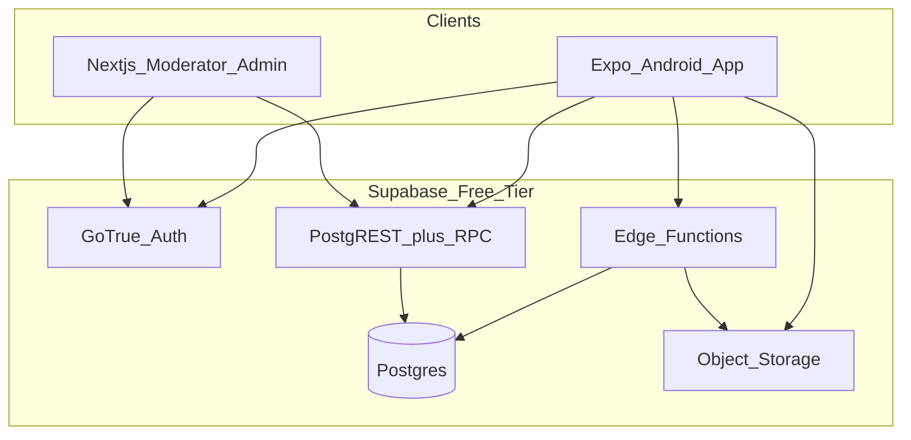
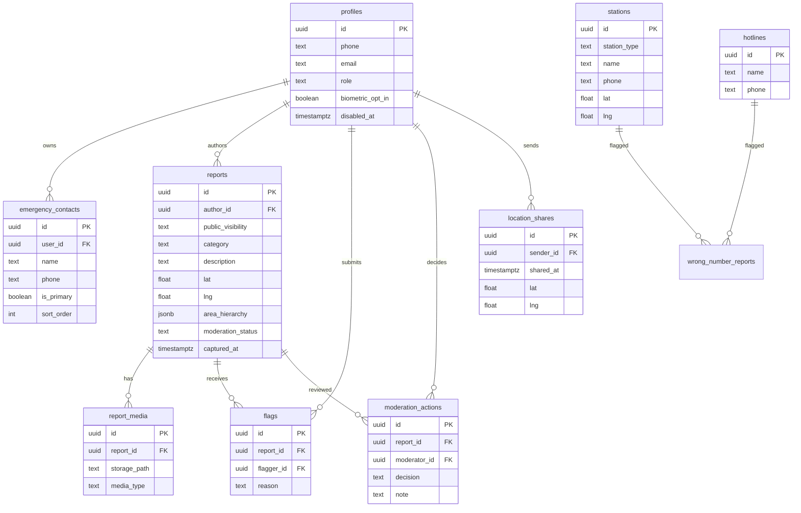
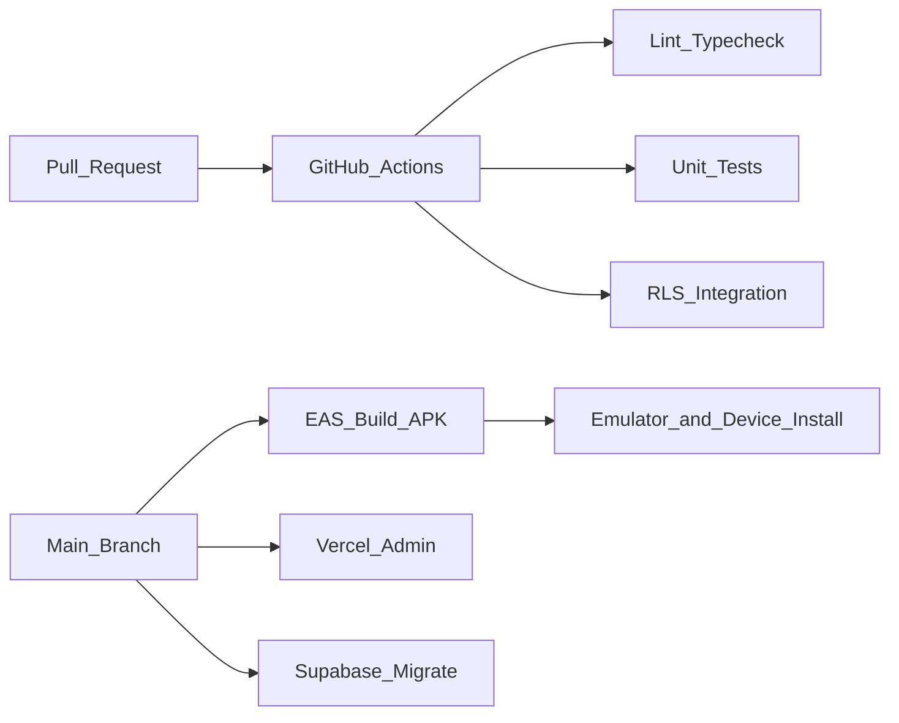

# Nagar Shield — System Architecture

> Primary technical reference for MVP Phase 1.  
> Status: confirmed after requirements clarification  
> Sources: `prd.md`, `brief.md`, `prototype ui.html`  
> Spec pack (`spec-nagar-shield/*`) was not present in the workspace; entity and API details derived from the PRD/brief are marked `[ASSUMPTION]` where they extend beyond explicit FR text.

---

## A. Project Overview

### System purpose

Nagar Shield is a Bangladesh-citizen mobile application that helps people act faster in panic moments and share situational awareness without becoming a public-safety intermediary. It prefills the system dialer with the right emergency number, supports anonymous-by-default incident capture, one-shot location sharing with trusted contacts, a local History view, and a Bangladesh-wide Alerts feed.

The product does **not** dispatch to police, fire, or hospitals. It never auto-dials. It never claims “we notified emergency services.”

### Business context

- Market: Bangladesh, MVP launch geography **Dhaka metro**
- Client priority: **Android-first**
- Scale target: ~1,000 active users over 90 days
- Training constraint: production-minded engineering on **free-tier** hosting and tooling; no paid production infrastructure required at this stage
- Distribution: installable on **Android emulator and real devices** via sideloaded APK/AAB (EAS Build). Google Play Store listing is **not** required for Phase 1

### Target users

| Priority | Persona | Need |
|---|---|---|
| Primary | Panic-moment user | Reach the correct number in one tap under stress |
| Secondary | Bystander | Capture evidence anonymously in &lt;30s |
| Tertiary | Situationally-aware resident | Browse local History and BD-wide Alerts |
| Quaternary | Asker | Reach non-emergency hotlines / thana / stations via More Help |
| Internal | Moderator | Review flagged Alerts (restore / remove) |

### MVP Phase 1 scope

**In scope (full PRD MVP):**

1. Authentication (phone + email, password, Remember me, biometric re-auth, email-OTP reset; SMS-OTP opt-in abstracted)
2. Help Alert — Police `999`, Medical `999`, Fire `102`, Personal Emergency contact picker
3. More Help — curated hotlines, nearest thana, find-a-station map
4. Capture — photo / video / file, anonymous default, GPS + timestamp, optional description, nullable category
5. Location Sharing — single snapshot to one or all primary contacts; non-app recipients via OS share sheet
6. History — local reports (default 1 km / 24 h), list + map, filters
7. Alerts — BD-wide feed, area filters, pull-to-refresh + 60s foreground refresh, flagging
8. Moderation — Next.js internal admin for hidden_pending_review queue
9. Bangla + English, dark / light mode, graceful permission denial

**Out of scope (Phase 2+ hooks only):** live location streaming, live Alerts push, social login, iOS, AI media classification, government dispatch APIs, heatmaps / crime prediction, nearest-station Fire routing, SIM-swap device-binding, languages beyond Bangla/English, prototype Charts / crime-stats admin (`S-23`).

**Showcase profile ([prd.md](prd.md) §9.1):** optional thinner delivery slice for demos. This architecture contracts to **full MVP**; Showcase cuts must not silently redefine the contract.

### Architectural objectives

1. Panic-path latency and honesty (dialer prefill &lt;12s median; never fake a call)
2. Modular monolith with clear domain boundaries (maintainable by a solo / small team)
3. Security-by-default for media, location, and identity
4. Free-tier feasibility without architectural dead-ends
5. Extensibility to Phase 2 without rewriting core modules

---

## B. Requirements Analysis

### Functional requirements (MVP modules)

| Module | PRD IDs | Summary |
|---|---|---|
| Auth | FR-AUTH-1..7 | Dual identifier signup; login phone **or** email + password; 30-day Remember me; biometric opt-in; email-OTP reset default; remote disable |
| Help Alert | FR-HELP-1..8 | Prefill dialer via OS intent; confirmation UX; Personal Emergency picker (no call-state failover) |
| More Help | FR-SEEK-1..6 | Hotlines / thana line / find-a-station; wrong-number flag |
| Capture | FR-CAPTURE-1..7 | Media + GPS/timestamp; anonymous default; ≤140 char description; category optional |
| Location | FR-LOC-1..4 | One-shot snapshot; OS share for non-users |
| History | FR-HIST-1..4 | 1 km / 24 h default; filters; immediate visibility |
| Alerts | FR-ALERTS-1..11 | National feed; 60s refresh; area filter; flag → auto-hide; anti-griefing |
| Moderation | FR-MOD-1..4 | Internal admin; restore / remove + note |
| Data / Privacy | FR-DATA-1..6 | Encrypt at rest/transit; retain server identity when anonymous; 90-day media delete; account deletion |
| Permissions | FR-PERMS-1..3 | Just-in-time permissions; degrade when denied |
| UX | FR-UX-1..5 | BN+EN; dominant Help Alert; dark/light; Material 48dp; WCAG AA |

### Non-functional requirements

| Concern | Target |
|---|---|
| Help Alert dialer-prefill | &lt;12s median from app open (Police / Medical / Fire) |
| Capture submit | &lt;30s median typical flow; upload &lt;5s on BD LTE when online |
| History / Alerts initial load | &lt;2s on warm session |
| Availability | Best-effort free tier; client offline queues for Capture |
| Locales | Bangla + English only |
| Platform | Android (API level per Expo supported range); real device + emulator |
| Cost | $0 required infrastructure; SMS is the only optional paid line item |

### Business rules

- App opens dialer; user taps Call. App never places or observes the call (C-1, C-6).
- Public Alerts show **content**, not author identity when `public_visibility = anonymous` (FR-NG-5).
- Server retains `user_id` for moderation even when public view is anonymous (FR-DATA-3).
- Reports appear immediately — no pending-review gate on publish (FR-HIST-3). Moderation is after-the-fact via flags.
- Fire = `102`; Police / Medical = `999` (confirmed override over older brief nearest-station wording).
- Location Sharing is a **single snapshot**, not a stream.
- Flag threshold starts at **3** → `hidden_pending_review` `[ASSUMPTION: OQ-4 confirmed as start value]`.
- Max 10 flags per user per hour; 5+ flagged reports in 24h auto-hides author’s last 24h reports.

### System constraints

| ID | Constraint |
|---|---|
| C-1 | No auto-dial |
| C-2 | Station DB = hardcoded Dhaka metro at MVP |
| C-3 | Alerts gated on moderation model |
| C-4 | Phone **and** email required at signup |
| C-5 | Must work when OS permissions denied |
| C-6 | No “emergency service” framing in store / marketing copy |
| C-7 | Media + location encrypted; never sold |
| C-8 | Bangla + English only |
| Budget | Free hosting / DB / storage / CI; sideload distribution |

### Assumptions and dependencies

| Tag | Assumption |
|---|---|
| A-CLIENT | Expo managed workflow + custom native modules only where Expo APIs insufficient |
| A-BACKEND | Supabase free project (Auth, Postgres, Storage, Edge Functions) |
| A-MAPS | MapLibre + OSM raster/vector tiles; attribution required |
| A-STATION | In-house curated Dhaka station + hotline dataset, mirrored in Postgres, quarterly refresh |
| A-GEO | Reverse-geocode via free Nominatim-compatible service with caching / rate limits, or bundled offline area hierarchy for Dhaka `[ASSUMPTION]` |
| A-SMS | SMS OTP behind feature flag; email OTP is default free path |
| A-MEDIA | Caps: 1080p video / 30s; photos compressed; 90-day hard-delete job |
| A-ALERTS-BATT | Pause 60s Alerts auto-refresh when battery &lt;20% |
| A-ADMIN | Single `moderator` role at MVP |
| A-SPECS | Missing `data-model.md` etc. → entities below are PRD-derived `[ASSUMPTION]` |
| Dep | Expo SDK, EAS Build, Supabase, Vercel (admin), GitHub Actions, MapLibre/OSM |

### Auth & MVP waivers (locked 2026-11-04)

These close the go/no-go conditions from the architecture review. Implementers and AI agents MUST follow them.

#### W-1 — Dual-identifier auth pattern (FR-AUTH-1)

**Decision:** Supabase Auth primary identity is **email**. `profiles.phone` (E.164) is a required, unique, verified attribute on the profile.

| Action | Behavior |
|---|---|
| Signup | Collect email + password + phone. Create Auth user with email. Store phone on `profiles`. |
| Email verify | Supabase email confirmation / email OTP (free). |
| Phone verify (MVP) | See W-2 — not paid SMS by default. |
| Login with email | Standard Supabase email + password. |
| Login with phone | Client looks up `profiles.phone` → resolves `user_id` / email via RPC (`resolve_login_identifier`), then signs in with email + password under the hood **or** returns a stable login hint. Password is the same credential for both identifiers. |
| Password reset | Email OTP by default (FR-AUTH-3). |

Do **not** create two separate Auth users for the same person. One `auth.users` row; dual login is identifier resolution + one password.

#### W-2 — Phone SMS verification (budget waiver)

**Decision:** Paid SMS OTP is **feature-flagged off** for MVP Phase 1 training/free-tier builds (`EXPO_PUBLIC_SMS_OTP_ENABLED=false`).

- Signup still **requires** a well-formed E.164 BD phone on `profiles` (format + uniqueness validated).
- Email remains the verified Auth channel for account recovery.
- When SMS budget exists, enable the flag and wire a provider (Twilio/MessageBird) for phone verify + optional SMS password-reset opt-in — without changing the W-1 identity model.
- Product copy must not claim “SMS-verified phone” while the flag is off; use “phone on file” / “verified email” language.

This is an explicit **MVP training waiver** of paid phone-SMS verification in FR-AUTH-1; the architecture still supports full SMS when funded.

#### W-3 — Reverse-geocode / area hierarchy (FR-CAPTURE-4)

**Decision:** **Dhaka-local area table first**; online Nominatim (or compatible) is backup only.

1. Primary: curated `area_lookup` (or equivalent) polygons / centroid grid for Dhaka metro → `area_hierarchy` `{ division, city, thana, neighborhood }`.
2. Cache hits in `geocode_cache`.
3. Online geocode only on cache miss, with allowlisted host, rate limits, and graceful degrade to `"Dhaka" / unknown thana` rather than failing Capture submit.

Do not block Capture upload on a live Nominatim call.

#### W-4 — Location Sharing 5s SLA (FR-LOC-2)

**Decision:** The “within 5s” requirement is measured as:

- **In-app / OS share path completed:** snapshot payload prepared and either (a) OS share sheet successfully presented / share intent fired, or (b) `location_shares` audit row written — median &lt;5s from user confirm.
- **Not** guaranteed SMS/WhatsApp carrier delivery or recipient open time (outside our control with OS share).

Telemetry: `location_share_intent_ms`. Do not build fake delivery receipts.

---

## C. Technology Stack

### Selected stack

| Layer | Technology |
|---|---|
| Mobile app | Expo (React Native) + TypeScript + Expo Router |
| Mobile UI | React Native + design tokens adapted from `prototype ui.html` |
| i18n | `i18next` / `expo-localization` (BN + EN) |
| Maps | MapLibre GL (React Native) + OpenStreetMap tiles |
| Backend platform | Supabase (Auth, Postgres, Storage, Edge Functions) |
| API surface | PostgREST + RPC + Edge Functions (TypeScript / Deno) |
| Validation | Zod (shared package) |
| Admin web | Next.js (App Router) + TypeScript on Vercel |
| Auth | Supabase Auth (email; phone provider optional) |
| Media | Supabase Storage (private buckets + signed URLs) |
| Background work | Expo background fetch / TaskManager for Capture retry; Supabase scheduled function / cron for media purge |
| Logging | Structured app logs + Supabase logs; Sentry optional free tier later |
| Testing | Jest + React Native Testing Library; Maestro or Detox for E2E; Playwright for admin |
| CI/CD | GitHub Actions + EAS Build |
| Package mgmt | pnpm workspaces (monorepo) |

### Decision rationale

**Expo + TypeScript**  
Android-first panic app needs dialer intents, camera, secure store, biometrics, and sideloadable APKs without a Play listing. Expo provides these via stable modules and EAS Build free tier. Alternatives: Flutter (excellent, but team chose RN/Expo), bare RN (more native maintenance), Capacitor PWA (weaker biometric / background / dialer fidelity).

**Supabase modular monolith**  
One free platform covers Auth + relational DB + Storage + server functions — matching PRD entities (reports, flags, contacts) better than Firestore. Alternatives: custom NestJS + Neon + S3 (more moving free-tier parts), Firebase (document model fights relational moderation), Appwrite (smaller Expo ecosystem).

**MapLibre + OSM**  
Zero mandatory map billing; attribution-compliant. Alternatives: Google Maps (UX strong, billing risk), Mapbox (free quota then pay).

**Next.js admin on Vercel**  
Small internal tool for FR-MOD without embedding moderation UX in the panic-path mobile app. Alternatives: Supabase Studio only (too weak as a product admin), in-app moderator mode (pollutes citizen UX).

**OS share sheet for location**  
Meets FR-LOC-4 without SMS API cost. Alternative: Twilio SMS (paid), require recipient app (excludes non-users).

### Free-tier options and limits

| Service | Free use | Watch-outs |
|---|---|---|
| Supabase Free | Auth MAUs, 500MB DB, 1GB storage, Edge Functions quotas | Pause on inactivity; upgrade or migrate before growth |
| Vercel Hobby | Admin hosting | Non-commercial hobby limits; fine for training/internal |
| EAS Build free | Limited monthly builds | Queue times; enough for sideload APKs |
| GitHub Actions | Public/private minutes | Keep CI lean |
| OSM / MapLibre | Tile usage policies | Cache; don’t hammer public tile servers; consider self-hosted tiles later |
| Email OTP | Supabase email | Deliverability to BD ISPs must be validated |
| SMS OTP | Not free at scale | Feature-flagged; Twilio/MessageBird only when budget allows |

---

## D. High-Level System Architecture

### Architectural style

**Modular monolith** on Supabase:

- Single Postgres database as system of record
- Domain modules owned as SQL schemas / tables + Edge Functions + shared Zod contracts
- Two clients (Expo citizen app, Next.js moderator admin) — not a microservice mesh
- No Kubernetes, no message broker required at MVP

### Major components

| Component | Responsibility |
|---|---|
| Expo Android app | Panic UX, Capture, History, Alerts, dialer intents, biometric unlock, OS share |
| Next.js admin | Moderator queue, restore/remove, notes, remote disable support UI |
| Supabase Auth | Signup/login, sessions, email OTP; optional phone OTP |
| PostgREST / RPC | CRUD for reports, contacts, flags, profiles under RLS |
| Edge Functions | Privileged workflows: finalize capture, reverse-geocode, flag threshold, media purge, admin actions |
| Postgres | Relational data, constraints, indexes, RLS |
| Storage | Encrypted-at-rest media objects; private buckets |
| Shared package | Types, Zod schemas, API error codes, area/category enums |

### Communication

- Mobile ↔ Supabase: HTTPS (TLS 1.3); JWT session; cert pinning on API host in production builds `[ASSUMPTION: pinning via expo-config plugin / native networking]`
- Admin ↔ Supabase: HTTPS + moderator JWT; service role **never** shipped to browsers — admin uses user JWT + RLS policies for `role = moderator`
- Alerts freshness: client pull-to-refresh + 60s foreground poll (no FCM live push at MVP)
- Location to non-users: native share intent with maps URL + timestamp text



### Design patterns

- **Feature modules** on mobile (Auth, Help, Seek, Capture, Location, History, Alerts, Settings)
- **Repository / data access** wrapping Supabase client
- **Result / typed errors** across API boundaries
- **Offline-first Capture queue** with exponential backoff (max 3 attempts, then local retry later)
- **RLS-first authorization** with Edge Functions for operations that must bypass or orchestrate multi-table writes

---

## E. Frontend Architecture

### Application structure (Expo)

Feature-first under `apps/mobile`:

- `app/` — Expo Router screens (file-based routes)
- `features/*` — domain UI + hooks + use-cases
- `shared/ui` — buttons, sheets, typography, panic-grid Help cards
- `shared/lib` — supabase client, secure store, i18n, permissions, dialer
- `shared/theme` — light/dark tokens from prototype

### Routing strategy

Expo Router groups:

- `(auth)` — login, register, forgot password / OTP
- `(onboarding)` — optional safety profile / contacts wizard (from prototype; skippable where PRD allows)
- `(app)` — Home (Help Alert dominant), Capture, Location, History, Alerts, More Help, Settings, Contacts
- Lock / biometric gate as root wrapper for returning sessions

Home **is** the Help Alert surface (panic-first): Police / Medical / Fire / Personal Emergency as dominant buttons; More Help one level deeper; Capture / Location / History / Alerts as secondary chips.

### Component organization

- Presentational components stay dumb; feature hooks own data fetching
- Panic controls: minimum **48×48 dp** tap targets; high-contrast emergency styles
- Confirmation sheet before dialer open: “Calling 999 — tap to confirm” / “Calling 102 — tap to confirm”
- No Charts / crime-stats screens

### State management

- Server state: TanStack Query (reports, alerts, history, contacts)
- Auth session: Supabase auth listener + secure token storage
- Ephemeral UI: React local state / context (theme, locale, capture draft)
- Avoid global Redux unless complexity forces it — not required for MVP

### API communication

- `@supabase/supabase-js` + typed RPC helpers from `packages/shared`
- Upload: direct-to-Storage with signed path policy, then `finalize_capture` Edge Function
- Errors mapped to user-visible BN/EN strings; never raw Postgres errors

### Forms and validation

- React Hook Form + Zod resolvers
- Shared schemas: signup, login, capture description (≤140), contact, flag reason

### Error and loading states

- Skeleton / spinner for History & Alerts (&lt;2s target)
- Capture: non-blocking “uploading…”; never block next Capture
- Permission denied: explicit fallbacks (manual dial guidance; hide camera controls)
- No signal: honest copy — do not pretend a call was placed
- Battery &lt;20%: pause Alerts auto-refresh; show quiet indicator
- Battery-saver / OEM modes that suppress dialer intents: warn and show manual dial guidance (FR-PERMS-3)
- Alerts row copy: `New alert from <area>: <category> — <user description>` (FR-ALERTS-5); missing category renders a neutral placeholder (e.g. “uncategorized”) `[ASSUMPTION]`

---

## F. Backend Architecture

### Layered modular monolith

```
Client
  → PostgREST / Edge Function gateway
    → Domain services (Capture, Alerts, Moderation, Seek, Location, Auth profile)
      → Postgres + Storage
```

Domain modules (logical, same DB):

| Module | Owns |
|---|---|
| `identity` | profiles, roles, remote disable, biometric preference flags |
| `help_seek` | stations, hotlines, wrong-number reports; nearest-thana query with 10 km fallback to `999` (FR-SEEK-3) |
| `capture` | reports, report_media, area_hierarchy extraction |
| `location` | location_shares audit records (optional) |
| `alerts` | feed queries, flags, rate limits |
| `moderation` | queue views, moderation_actions |
| `jobs` | media purge, optional geocode cache cleanup |

### Business logic organization

- **Simple CRUD + RLS:** contacts, profile updates, wrong-number flags
- **Edge Functions:** capture finalize (strip/replace location metadata bookkeeping, reverse-geocode), apply flag + threshold transition, moderator restore/remove, account disable, media purge
- **Client-only:** Help Alert dialer (no server call required for dial)

### API design principles

- Prefer RPC for multi-step writes (`finalize_capture`, `flag_report`, `moderation_decide`)
- Prefer PostgREST views for read models (`alerts_feed`, `history_nearby`)
- All mutations authenticated except health

### Request validation

- Zod schemas shared with clients
- DB CHECK constraints for enums and length caps
- Storage MIME / size validation on upload policies

### Authentication and authorization

- Citizen: authenticated user JWT
- Moderator: same Auth users with `profiles.role = 'moderator'`
- RLS policies enforce visibility (anonymous author hiding, own-report edit of category, moderator queue access)
- Service role key: Edge Functions and CI only — never in mobile or admin browser bundles

### Error handling

Standard error envelope (see §I). Edge Functions catch and map to stable `code` values (`AUTH_DISABLED`, `FLAG_RATE_LIMIT`, `MEDIA_TOO_LARGE`, etc.).

### Logging

- Edge Function structured JSON logs (request id, user id hash, action)
- No raw GPS or media payloads in logs
- Admin actions always write `moderation_actions.note`

---

## G. Database Architecture

### Database selection

**PostgreSQL** via Supabase. Relational integrity fits reports ↔ media ↔ flags ↔ moderation; PostGIS optional for distance queries `[ASSUMPTION: enable PostGIS for History 1 km radius]`.

### Core entities `[ASSUMPTION: derived from PRD]`

| Entity | Purpose |
|---|---|
| `profiles` | Extends `auth.users`; phone E.164, email, role, locale, theme, biometric_opt_in, disabled_at |
| `emergency_contacts` | Name, phone, is_primary, sort_order, owner profile |
| `reports` | Media-backed incident; lat/lng; timestamp; description; category nullable; visibility; area_hierarchy; moderation_status |
| `report_media` | Storage path, type, size, duration |
| `flags` | report_id, flagger_id, reason enum, created_at |
| `moderation_actions` | report_id, moderator_id, decision, note, created_at |
| `stations` | Dhaka metro police/hospital/fire; name, type, phone, lat/lng |
| `hotlines` | Curated non-emergency numbers |
| `wrong_number_reports` | User reports on stations/hotlines |
| `location_shares` | Optional audit of snapshot shares (timestamp, recipient type) |
| `geocode_cache` | Optional cache for reverse-geocode |

### Category enum (fixed 11 values) `[ASSUMPTION: names aligned to product language; exact list tunable]`

`theft`, `assault`, `harassment`, `robbery`, `accident`, `fire`, `medical`, `fraud`, `vandalism`, `suspicious`, `other`

### Flag reason enum

`misinformation`, `harassment`, `duplicate`, `off_topic`, `other`

### Moderation status

`visible` → `hidden_pending_review` → `restored` (visible) | `removed`

### ER diagram



### Data integrity

- FK cascades carefully: soft-hide reports; hard-delete media objects after 90 days; keep metadata longer (FR-DATA-4)
- CHECK: description length ≤140; visibility in (`anonymous`,`identified`); role in (`citizen`,`moderator`)
- Unique: one flag per (report_id, flagger_id)
- Partial indexes for feed queries

### Indexing strategy

- `reports (captured_at DESC)` for Alerts recency
- `reports` geo index (PostGIS `geography` or lat/lng btree + app filter) for History 1 km
- `reports (moderation_status)` for admin queue
- `flags (report_id)`, `flags (flagger_id, created_at)` for rate limits
- `stations` geo index for nearest thana
- `profiles (phone)`, `profiles (email)` unique

### Migration strategy

- Supabase SQL migrations under `supabase/migrations/`
- Forward-only migrations in CI; never edit applied migrations
- Seed: Dhaka stations/hotlines + optional demo reports for local/dev

### Backup and recovery

- Supabase free-tier daily backups / point-in-time per plan limits — document restore drill
- Export station/hotline JSON retained in repo as source of truth for curation
- Account deletion: soft-delete + 30-day recovery window, then purge PII (FR-DATA-6)

---

## H. Security Architecture

### Authentication

- Signup requires verified phone (E.164) **and** verified email (C-4)
- Login: phone **or** email + password
- Sessions: Supabase JWT; Remember me → 30-day refresh persistence in secure storage
- Password reset: email OTP default (10 min validity; max 3 attempts → 30 min cooldown)
- SMS OTP: Settings opt-in with carrier-charge disclosure; provider abstracted
- Biometric: local device re-auth unlock of existing session; 3 fails → password; 5 fails / 24h → auto-disable biometric preference
- Remote disable: `profiles.disabled_at` set; app shows support message on next open (FR-AUTH-7)
- No social login at MVP

### Authorization / RBAC

| Role | Capabilities |
|---|---|
| `citizen` | Own profile/contacts; create reports; flag; read visible feeds; Help/Seek |
| `moderator` | Citizen capabilities + review queue + restore/remove + view author server-side |

RLS examples (conceptual):

- Public feed select: `moderation_status in ('visible','restored')` and strip author when anonymous
- Update category: only `author_id = auth.uid()`
- Moderation tables: `profiles.role = 'moderator'`

### Input validation and sanitization

- Zod at edge and client
- Strip EXIF; replace GPS with app-supplied coordinates (FR-CAPTURE-2)
- Description plain text only; no HTML
- Rate limits on flags and capture submissions `[ASSUMPTION: capture rate limits per OQ-6 — start with per-user daily cap enforced in Edge Function]`

### Session management

- SecureStore for tokens on device
- Refresh rotation via Supabase Auth
- Logout clears local session + capture queue credentials

### API security

- TLS 1.3 only
- Cert pinning on API host in release builds
- CORS locked for admin origin
- Storage: private buckets; signed read URLs short-lived
- No service-role keys on clients

### Data protection

- Device: media drafts in app sandbox; OS keystore/encrypted storage where available (FR-DATA-1)
- Server: Storage encryption at rest (platform KMS); DB encryption at rest
- Do not sell/share data (FR-DATA-5)
- Minimize logs; hash identifiers where possible

### Secrets and environment

- `.env` local only; EAS secrets / Vercel / GitHub Environments for CI
- Separate Supabase projects: `dev` and `prod` if free-tier allows; else schema-prefixed careful single project for training `[ASSUMPTION]`

### OWASP-oriented controls

| Risk | Mitigation |
|---|---|
| Injection | Parameterized SQL via PostgREST; Zod validation |
| Broken auth | Verified identifiers; cooldown; remote disable |
| Broken access control | RLS + role checks |
| Security misconfig | No public buckets; no debug keys in release |
| Sensitive data exposure | Anonymous public projection; encrypted media |
| XSS (admin) | React escaping; CSP headers on Next.js |
| Insecure design | No auto-dial; no dispatch claims |
| Rate limits | Flag/capture/OTP throttles |
| SSRF | Edge Functions allowlist geocode hosts only |

---

## I. API Design

### Conventions

- Base: Supabase project URL
- Auth header: `Authorization: Bearer <jwt>`
- Prefer RPC for writes with business rules; views for reads
- Timestamps: ISO-8601 UTC
- IDs: UUID v4

### Endpoint organization (logical)

| Area | Method | Path / RPC | Notes |
|---|---|---|---|
| Auth | — | Supabase Auth endpoints | signup, login, OTP, logout |
| Profile | GET/PATCH | `/rest/v1/profiles` | own row |
| Contacts | CRUD | `/rest/v1/emergency_contacts` | owner RLS |
| Capture | POST | `/functions/v1/finalize_capture` | after Storage upload |
| History | GET | `/rest/v1/rpc/history_nearby` | radius, window, category |
| Alerts | GET | `/rest/v1/rpc/alerts_feed` | area filters, cursor |
| Flag | POST | `/functions/v1/flag_report` | reason enum + rate limit |
| Seek | GET | `/rest/v1/stations`, `hotlines` | public read |
| Wrong number | POST | `/rest/v1/wrong_number_reports` | authenticated |
| Location audit | POST | `/rest/v1/location_shares` | optional |
| Moderation queue | GET | `/rest/v1/rpc/moderation_queue` | moderator |
| Moderation decide | POST | `/functions/v1/moderation_decide` | restore/remove + note |
| Admin disable | POST | `/functions/v1/disable_user` | moderator |

### HTTP status codes

| Code | Use |
|---|---|
| 200 / 201 | Success |
| 400 | Validation failure |
| 401 | Missing/invalid session |
| 403 | Disabled user / forbidden role |
| 404 | Not found |
| 409 | Conflict (duplicate flag) |
| 429 | Rate limited |
| 500 | Unexpected |

### Request / response shapes (examples)

`finalize_capture` request:

```json
{
  "storage_path": "reports/{author_token}/{client_request_id}/{file}",
  "media_type": "photo",
  "lat": 23.7808,
  "lng": 90.4074,
  "captured_at": "2026-11-03T18:00:00.000Z",
  "description": "Snatch theft near New Market",
  "public_visibility": "anonymous",
  "category": null
}
```

`{author_token}` is the hex SHA-256 of the uploader's user id — **not** the id
itself. The public alert detail hands the media path to every signed-in
reader so the client can mint a short-lived signed URL, so a path carrying the
author's uuid would hand every reader a stable handle on the author. The
token lets the author prove a path is theirs — the Storage insert policy
compares the segment against `digest(auth.uid()::text, 'sha256')` — without the
id being visible or recoverable. See
`supabase/migrations/20261105000029_storage_author_token.sql`.

Success:

```json
{
  "data": {
    "report_id": "…",
    "area_hierarchy": { "division": "Dhaka", "city": "Dhaka", "thana": "…", "neighborhood": "…" },
    "moderation_status": "visible"
  }
}
```

### Error response format

```json
{
  "error": {
    "code": "FLAG_RATE_LIMIT",
    "message": "Too many flags. Try again later.",
    "details": { "retry_after_sec": 3600 }
  }
}
```

Client maps `code` → BN/EN strings.

### Versioning

- MVP: no public external API versioning; breaking changes via new RPC names
- If a partner API appears later: `/v1/` prefix on Edge Functions only

---

## J. Testing Architecture

### Unit testing

- Jest for domain helpers (rate-limit math, dialer number selection, area filter, Zod schemas)
- Shared package tests run in CI first (fast feedback)

### Integration testing

- Supabase local (`supabase start`) + SQL tests / pgTAP or Node scripts against RLS policies
- Edge Function tests with mocked Storage / geocode

### API testing

- Contract tests for RPC envelopes and error codes
- Moderator vs citizen permission matrix tests

### End-to-end testing

- Mobile: Maestro or Detox on Android emulator — panic path (open → confirm → dialer intent), Capture happy path, Alerts filter
- Admin: Playwright — login as moderator → restore/remove

### Security testing

- RLS negative tests (cannot read anonymous author_id; cannot moderate as citizen)
- Storage signed URL expiry checks
- OTP brute-force cooldown verification

### Test data management

- Seed scripts: Dhaka stations/hotlines + ~60 synthetic reports across 8 areas (also useful for Showcase demos)
- Factories in `packages/shared/testing`
- Never use production PII in fixtures

### CI execution strategy

On each PR (GitHub Actions):

1. Lint + typecheck (`mobile`, `admin`, `shared`, `functions`)
2. Unit + shared tests
3. Supabase migration dry-run + RLS integration tests
4. (Nightly / main) EAS build Android APK smoke + Maestro subset

Fail PR on type/lint/unit/RLS failures.

---

## K. DevOps and Deployment Architecture

### Environments

| Env | Purpose |
|---|---|
| Local | Expo Go / dev client + Supabase local + admin `localhost` |
| Staging | Shared Supabase free project (or branch DB) + Vercel preview + internal APK |
| Production | Supabase project + Vercel prod + EAS production APK sideload |

Staging may collapse into a single non-prod project under free-tier limits; document the compromise.

### CI/CD pipeline



### Build and deployment

- **Mobile:** `eas build -p android --profile preview` → APK; install via `adb` / device file share
- **Admin:** Vercel deploy from `apps/admin`
- **DB:** `supabase db push` / linked CI migration with review

### Environment variables

| Name | Where |
|---|---|
| `EXPO_PUBLIC_SUPABASE_URL` | Mobile |
| `EXPO_PUBLIC_SUPABASE_ANON_KEY` | Mobile |
| `SUPABASE_SERVICE_ROLE_KEY` | Edge Functions / CI only |
| `NEXT_PUBLIC_SUPABASE_URL` | Admin |
| `NEXT_PUBLIC_SUPABASE_ANON_KEY` | Admin |
| `GEOCODE_BASE_URL` | Edge Functions |
| `SMS_PROVIDER_*` | Edge / Auth hook (optional flag) |
| `SENTRY_DSN` | Optional |

### Monitoring and logging

- Supabase dashboard: Auth errors, function invocations, storage size
- Mobile: startup-to-dialer telemetry `app_open_to_dialer_ms` (success metric)
- Alerts: flag rates, hide/remove rates (counter-metrics)
- Free-tier: no paid APM required; add Sentry when needed

### Free hosting summary

| Piece | Host |
|---|---|
| API / DB / Auth / Storage | Supabase Free |
| Admin web | Vercel Hobby |
| Mobile binaries | EAS Build → sideload |
| CI | GitHub Actions |
| Maps | OSM + MapLibre |
| Email OTP | Supabase Auth email |

### Limitations and migration considerations

- Supabase free project pause → keep a heartbeat or accept cold-start for training
- Storage 1GB → enforce media caps + 90-day purge early
- If outgrowing free tier: move Postgres to Neon + Storage to Cloudflare R2 without changing domain modules (keep Supabase Auth or migrate sessions carefully)
- Play Store submission is Phase-later; keep package naming / signing keys ready

---

## L. Project Structure

```text
nagar-shield/
├── apps/
│   ├── mobile/                 # Expo React Native citizen app
│   │   ├── app/                # Expo Router screens
│   │   ├── features/           # auth, help, seek, capture, location, history, alerts, settings
│   │   ├── shared/             # ui, theme, lib (supabase, dialer, i18n, permissions)
│   │   ├── assets/
│   │   ├── app.config.ts
│   │   └── package.json
│   └── admin/                  # Next.js moderator console
│       ├── app/
│       ├── components/
│       ├── lib/
│       └── package.json
├── packages/
│   └── shared/                 # Zod schemas, types, enums, API codes, i18n keys contract
│       ├── src/
│       └── package.json
├── supabase/
│   ├── migrations/             # SQL schema + RLS
│   ├── functions/              # finalize_capture, flag_report, moderation_decide, …
│   ├── seed/                   # stations, hotlines, sample reports
│   └── config.toml
├── tools/                      # scripts: seed, geocode check, media purge dry-run
├── .github/workflows/          # CI
├── prd.md
├── brief.md
├── prototype ui.html
├── ARCHITECTURE.md             # this document
├── pnpm-workspace.yaml
└── README.md
```

**Responsibilities:**

- `apps/mobile` — only citizen UX and device integrations
- `apps/admin` — only moderation / trust tooling
- `packages/shared` — single source of truth for contracts
- `supabase/` — schema, policies, privileged workflows
- Docs at repo root remain product/architecture sources of truth

---

## M. Scalability and Future Evolution

### What we deliberately do **not** build now

Microservices, Kafka, Redis clusters, Kubernetes, live websocket Alerts, multi-region active-active.

### Extension points (no rewrite required)

| Phase 2 capability | Hook left in MVP |
|---|---|
| Live location streaming | `location_shares` model + `mode` field (`snapshot` \| `stream`) |
| Alerts push | Keep feed RPC; add FCM topic fanout later |
| Social login | Supabase Auth providers already pluggable |
| iOS | Expo multi-platform project; Android policies remain source of truth |
| AI media classification | Async job table + Storage event trigger |
| Nearest Fire station | `stations` already typed; Help Alert number resolver interface |
| Device-binding / SIM-swap | `profiles` security fields reserved |
| Stronger admin RBAC | `role` expands to `trust_safety` / `admin` |

### Scale path

1. Stay on Supabase until DB/storage quotas bite  
2. Add read replicas / paid Supabase  
3. Extract Edge Functions that are hot into a dedicated API only if needed  
4. Introduce queue (e.g. Cloud Tasks / free alternative) only for media purge / AI — not for Help Alert path

---

## N. Architectural Decision Records

### ADR-001 — Modular monolith on Supabase

- **Decision:** Single Supabase project as backend monolith with domain modules  
- **Context:** Solo/small team, free tier, relational PRD  
- **Alternatives:** NestJS microservice set; Firebase  
- **Consequences:** Fast delivery; free-tier coupling; migrate storage/DB later if needed without rewriting mobile features

### ADR-002 — Expo (React Native) Android-first

- **Decision:** Expo managed + EAS APK sideload  
- **Context:** Need dialer, camera, biometric, real-device install without Play Store  
- **Alternatives:** Flutter; bare RN; PWA  
- **Consequences:** Strong Android path; iOS deferred cleanly; EAS free build limits apply

### ADR-003 — Help Alert is client-side dialer only

- **Decision:** No server involvement to “place” emergency calls; `tel:` / intent after confirmation  
- **Context:** C-1, C-6, FR-HELP-6  
- **Alternatives:** Voip / gateway dial (rejected — dispatch-like)  
- **Consequences:** Honest UX; Personal Emergency cannot observe no-answer; 25s “call next” is UI-only

### ADR-004 — MapLibre + OpenStreetMap

- **Decision:** Free maps for History and Find-a-station  
- **Alternatives:** Google Maps; Mapbox; list-only  
- **Consequences:** No map billing surprise; must respect OSM tile usage; UX slightly less “Google-native”

### ADR-005 — Location share via OS share sheet

- **Decision:** Non-app recipients get system share (SMS/WhatsApp/etc.)  
- **Alternatives:** Twilio SMS; app-only recipients  
- **Consequences:** $0 delivery; inconsistent SMS formatting across apps; no delivery receipt

### ADR-006 — Next.js moderator admin

- **Decision:** Separate web admin for FR-MOD  
- **Alternatives:** Supabase Studio only; in-app moderator mode  
- **Consequences:** Clear RBAC boundary; extra small app to maintain on Vercel free

### ADR-007 — Email OTP default; SMS feature-flagged

- **Decision:** Free email OTP for reset; SMS optional paid path  
- **Context:** Budget + PRD free-first auth  
- **Consequences:** See **W-1 / W-2** — email is Auth primary; phone on profile; SMS verify flagged off until funded

### ADR-011 — Auth & MVP waivers (W-1..W-4)

- **Decision:** Lock dual-login via email-primary Auth + phone profile; SMS off by default; Dhaka-local geocode first; location 5s = intent/audit not carrier delivery  
- **Context:** Architecture review go/no-go conditions (2026-11-04)  
- **Consequences:** FR-AUTH-1 SMS verify deferred under training waiver; Capture not blocked on Nominatim; location metrics stay honest

### ADR-008 — Full MVP contract; Showcase optional

- **Decision:** Architecture targets full PRD MVP; Showcase is a delivery profile, not a reduced contract  
- **Consequences:** Implement behind flags if demo needs thinner slice; do not drop OTP/moderation/maps from the design

### ADR-009 — In-house Dhaka station/hotline curation

- **Decision:** Curated dataset in repo + Postgres mirror (OQ-1)  
- **Alternatives:** External open dataset only  
- **Consequences:** Ownership of quarterly refresh; wrong-number flag feeds curator workflow

### ADR-010 — No crime-stats / Charts in product

- **Decision:** Exclude prototype `S-23` Charts admin  
- **Context:** FR-NG-3, FR-NG-4  
- **Consequences:** Admin is moderation-only; analytics limited to product telemetry, not public crime dashboards

---

## O. Implementation Guidelines

Rules for human developers and AI coding agents:

1. **Never auto-dial.** Only open the OS dialer after explicit confirmation. Never claim a call connected.
2. **Never build dispatch, heatmaps, crime prediction, or public author profiles** in MVP.
3. **Prefer RLS + RPC over ad-hoc client privilege.** No service-role keys in apps.
4. **Keep Help Alert offline-capable** for number display / dialer intent even when API is down. Ship curated Dhaka stations/hotlines in the app bundle and mirror in Postgres (FR-SEEK-5 / C-2). Thana lookup: nearest within 10 km, else fall back to `999` with banner (FR-SEEK-3).
5. **Capture must not block.** Failed uploads queue locally with backoff; max 3 attempts then retry later.
6. **Anonymous is the default public visibility**; server still stores `author_id`.
7. **Category is optional at Capture**; editable later by author in History detail.
8. **All user-facing strings** go through i18n (BN + EN); no hardcoded English-only UI in features.
9. **Material 48dp** minimum tap targets on interactive controls; WCAG AA contrast in both themes.
10. **Shared Zod schemas** are the contract — update `packages/shared` before clients diverge.
11. **Migrations are forward-only.** Seed stations/hotlines from curated JSON.
12. **Media caps:** enforce 1080p / 30s video and image compression before upload.
13. **Alerts poll** every 60s in foreground only; pause under 20% battery.
14. **Flag threshold = 3** to hide; moderator restore/remove requires a note.
15. **Feature-flag SMS OTP** until a funded provider is configured; do not hardcode Twilio into core auth flow.
16. **Do not implement Charts / Total Crime dashboards** from the HTML prototype.
17. **Sideload APK via EAS** for emulator and real devices; Play Store listing is out of scope for Phase 1.
18. **When unsure,** prefer the PRD over the brief; prefer this architecture over inventing new services.
19. **Mark new inferences** with `[ASSUMPTION]` in PRs if they extend beyond PRD/architecture.
20. **Panic path first:** if a change risks Home → dialer latency or clarity, reject it.

### Suggested implementation order

1. Monorepo scaffold + Supabase schema/RLS + shared Zod  
2. Auth + biometric gate  
3. Help Alert + More Help (stations/hotlines seed)  
4. Capture + Storage + History list  
5. MapLibre History / Find-a-station  
6. Alerts feed + flag RPC  
7. Moderator admin  
8. Location snapshot + OS share  
9. Telemetry for dialer timing + CI/EAS APK pipeline  

---

## Appendix — Traceability

| PRD area | Architecture section |
|---|---|
| FR-AUTH | E, F, H, I |
| FR-HELP / FR-SEEK | E, ADR-003, ADR-009 |
| FR-CAPTURE | E, F, G, O |
| FR-LOC | E, ADR-005 |
| FR-HIST / FR-ALERTS | E, F, G, I |
| FR-MOD | F, apps/admin, ADR-006 |
| FR-DATA / FR-PERMS / FR-UX | H, E, O |
| Non-goals / Phase 2 | A, M, ADR-008, ADR-010 |
| Free-tier constraint | C, K |

---

*End of ARCHITECTURE.md — MVP Phase 1 technical reference.*
