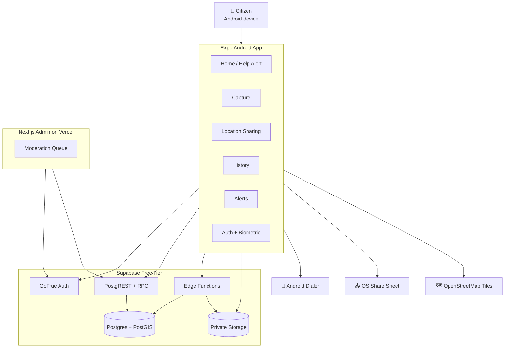

# System Context: Nagar Shield MVP Phase 1

## System Purpose

Nagar Shield is a Bangladesh-citizen **Android** application that helps people
act faster in panic moments and share situational awareness **without becoming
a public-safety intermediary**. It prefills the system dialer with the right
emergency number, supports anonymous-by-default incident capture, one-shot
location sharing with trusted contacts, a local History view, and a
Bangladesh-wide Alerts feed.

The product **does not** dispatch to police, fire, or hospitals. It never
auto-dials. It never claims "we notified emergency services."

## System Boundary

```
┌──────────────────────────────────────────────────────────────────────┐
│  OUTSIDE THE SYSTEM                                                  │
│                                                                      │
│  • Android OS dialer        (we fire ACTION_DIAL; the OS places)   │
│  • OS share sheet           (SMS / WhatsApp / any system target)    │
│  • OpenStreetMap tiles      (public tile servers, attribution req.) │
│  • Supabase Auth email      (OTP delivery for password reset)       │
│  • Optional SMS provider    (feature-flagged OFF in Phase 1)        │
│  • Nominatim-compatible API (backup reverse-geocode only)           │
│  • Moderator humans         (operate the Next.js console)           │
└──────────────────────────────────────────────────────────────────────┘
```

| Boundary | We own it? | Note |
|---|---|---|
| Dialer intent | **No** — we fire an intent and stop | Never observe call state |
| Call placement / outcome | **No** | C-1; forbidden to implement |
| Message delivery receipt | **No** | ADR-005; no delivery receipt is ever fabricated |
| Map tiles | **No** | OSM public tiles, attribution required |
| Emergency dispatch | **No** | C-6; app-store-safe framing |
| Report storage & moderation | **Yes** | Supabase Postgres + Storage |
| Identity & sessions | **Yes** | Supabase Auth |
| Curated station / hotline data | **Yes** | In-house Dhaka dataset, quarterly refresh |
| Moderation decisions | **Yes** | Next.js admin on Vercel |

## Actors

| Actor | Description | Interaction |
|---|---|---|
| **Panic-moment user** (primary) | Adult in Dhaka, stressed, needs the right number now | Opens app → biometric unlock → taps Police/Medical/Fire → dialer opens |
| **Bystander** | Sees an incident in progress, wants evidence without exposure | Capture → photo → optional note → send (anonymous by default) |
| **Situationally-aware resident** | Calm user browsing local and national incidents | Alerts feed → area filter → History |
| **Asker** | Needs a non-emergency service number | More Help → hotlines / thana line / find a station |
| **Moderator** (internal) | Reviews flagged content | Next.js console → queue → restore/remove with a note |
| **Curator** (internal) | Maintains the station & hotline datasets | Reviews wrong-number reports → quarterly refresh |

## System Context Diagram



## Data Flows

### DF-1 — Help Alert (the panic path)

```
Tap Police card
  → confirmation sheet ("Calling 999 — tap to confirm.")
  → show app_open_to_dialer_ms
  → fire ACTION_DIAL intent with 999
  → OS dialer opens pre-filled
```

No network call. No server involvement. Must work offline. Must never
auto-dial. The app does **not** observe whether the call connected.

### DF-2 — Capture (anonymous report)

```
Camera / gallery / file
  → strip EXIF, attach app GPS + timestamp
  → (optional) description ≤140 chars
  → (optional) toggle identified
  → upload direct to private Storage bucket
  → POST finalize_capture Edge Function
       → reverse-geocode (Dhaka-local table first, online backup)
       → insert reports row (author_id always set)
       → insert report_media row
       → return area_hierarchy + moderation_status
  → report visible immediately (no pending-review gate)
  → on failure: queue locally, exponential backoff, max 3 attempts
```

### DF-3 — Location Sharing (one-shot snapshot)

```
Confirm share
  → get single GPS fix
  → for each selected contact:
       if app user    → insert location_shares audit row (mode='snapshot')
       else           → fire OS share intent with location + timestamp text
  → record location_share_intent_ms
```

One shot. Never a stream. No delivery receipt is ever claimed.

### DF-4 — Alerts feed

```
Alerts screen opens
  → GET alerts_feed (cursor pagination, area filters)
  → public projection: author_id omitted when public_visibility='anonymous'
  → poll every 60 s while foregrounded (pause if battery < 20%)
  → pull-to-refresh
  → flag → POST flag_report (reason enum)
       → rate limit check (10/hour)
       → insert flag
       → if count >= 3 → report → hidden_pending_review
       → if author flagged 5+ reports in 24 h → author's last 24 h → hidden_pending_review
```

### DF-5 — Moderation

```
Moderator signs in (profiles.role = 'moderator')
  → GET moderation_queue
  → sees report + media + flag reasons + uploader (server-side only)
  → POST moderation_decide (restore | remove) + required note
  → insert moderation_actions row
  → restored → report reappears in public feed
  → removed  → report permanently absent from public feed
```

### DF-6 — Auth

```
Signup: email + password + phone (E.164)
  → Supabase Auth creates the email user
  → profiles row created (phone unique, role='citizen')
  → email verification via OTP

Login: phone OR email + password
  → resolve identifier → email (profiles.phone unique lookup)
  → sign in with email + password
  → "Remember me" → refresh token persisted in SecureStore (30 days)
  → biometric opt-in → local re-auth gate on next open
```

## Data Sensitivity Classification

| Data | Class | Storage | Retention | Public? |
|---|---|---|---|---|
| Report media (photo/video/file) | **High** | Private Storage bucket, encrypted at rest | Hard-delete at **90 days** | Only via short-lived signed URL |
| Report GPS coordinates | **High** | Postgres, `reports` | Metadata retained longer | Shown at area granularity in feeds, not raw coords |
| `author_id` | **High** | Postgres | With the account | **Never** — server-side only |
| Emergency contacts (name, phone) | **High** | Postgres | With the account | Never |
| Phone number | **High** | `profiles.phone` | With the account | Never |
| Email | Medium | Supabase Auth + `profiles` | With the account | Never |
| Area hierarchy | Low | `reports.area_hierarchy` | With the report | **Yes** — this is what feeds expose |
| Category, description | Low–Medium | `reports` | With the report | **Yes** (description is user-authored, shown as written) |
| Description | Low | `reports.description` | With the report | **Yes** |
| Moderation notes | Internal | `moderation_actions.note` | With the report | Never |

## Deployment Context

| Environment | Mobile | Backend | Admin |
|---|---|---|---|
| **Local** | Expo dev client on emulator | `supabase start` (Docker) | `next dev` on :3000 |
| **Staging** | Internal APK | Shared Supabase free project | Vercel preview |
| **Production** | EAS production APK (sideload) | Supabase project | Vercel production |

Mobile distribution: **sideloaded APK only**. Google Play Store listing is not
required for Phase 1.

## Key Architectural Properties

| Property | How it is achieved |
|---|---|
| Panic-path latency | Home is the Help Alert surface; the dialer path is zero-network; numbers are bundled in the app |
| Honesty | No auto-dial, no call observation, no delivery receipts, no dispatch claims |
| Modular boundaries | 7 domain modules (`identity`, `help_seek`, `capture`, `location`, `alerts`, `moderation`, `jobs`) over one Postgres |
| Security by default | RLS-first; service-role key confined to Edge Functions + CI; anonymous public projection |
| Free-tier feasibility | Supabase + Vercel + EAS + GitHub Actions = $0; caps and 90-day purge keep storage under quota |
| Phase-2 extensibility | `location_shares.mode`, pluggable Auth providers, typed `stations`, expandable `role`, feed RPC retained for FCM fanout |

## Quality Attributes (measurable)

| Attribute | Measure | Target |
|---|---|---|
| Responsiveness (panic path) | `app_open_to_dialer_ms` median | < 12,000 ms |
| Responsiveness (capture) | `capture_open_to_submit_ms` median | < 30,000 ms |
| Responsiveness (feeds) | History / Alerts warm load | < 2,000 ms |
| Responsiveness (share) | `location_share_intent_ms` median | < 5,000 ms |
| Privacy | Anonymous public projection | 0 leaks of `author_id` in public reads (RLS negative tests) |
| Privacy | Media retention | 100% hard-deleted at 90 days |
| Accessibility | Tap targets / contrast | 100% controls ≥ 48 dp; WCAG AA verified in both themes |
| Localisation | String coverage | 100% of keys present in `bn` and `en` |
| Cost | Infrastructure spend | $0 required |
